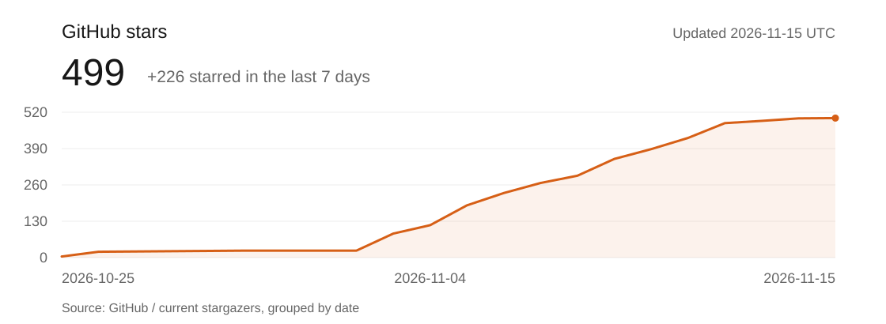

<p align="center">
  <picture>
    <source media="(prefers-color-scheme: dark)" srcset="public/brand/happyhands-logo-paper.png">
    
  </picture>
</p>

<h3 align="center">UI review and product experience improvements for coding agents.</h3>

<p align="center">Capture real pages, diagnose what actually breaks the task, fix it in an isolated worktree, and judge the result on before/after evidence.</p>

<p align="center">
  <a href="https://happyhands.cc"></a>
  <a href="https://github.com/ShuaiMXu/happyhands/releases/tag/v1.1.0"></a>
  <a href="https://github.com/ShuaiMXu/happyhands/stargazers"></a>
  <a href="docs/harness.md"></a>
</p>

<p align="center">
  <a href="#install">Install</a> · <a href="#how-it-works">How it works</a> · <a href="#use-your-coding-agent">Your agent</a> · <a href="#scope-and-limits">Limits</a> · <a href="https://happyhands.cc">Website</a> · <a href="README.zh-CN.md">简体中文</a>
</p>

HappyHands is a local Harness that gives a coding agent a design-review loop it can be held to. It drives your existing Chrome or Edge against a real preview, captures the states a user task passes through, and reports problems that have a reproducible observation behind them — then makes the repair in an isolated Git worktree and asks a separate reviewer to judge the before/after evidence. You drive it from the CLI, or from the optional local workbench.

https://github.com/user-attachments/assets/19607c8f-3fb4-4db5-826e-ff664980dbce

<sub>37-second demo: capture → diagnose → isolated repair → independent review → your decision.</sub>

## Install

From the product repository you want reviewed, with Node.js 22.15+ and npm:

```sh
npx --yes --package=https://github.com/ShuaiMXu/happyhands/releases/download/v1.1.0/happyhands-lite-1.1.0.tgz happyhands install
```

This installs the lightweight Skill — runtime, pinned methods and eight runtime dependencies — into your Codex user Skill directory (`~/.codex/skills/happyhands`, or under `CODEX_HOME`) and never overwrites an existing install. Add `--agent claude-code`, `--agent dsh` (`~/.agents/skills`), or `--scope project` (`.agents/skills/happyhands`) for another discovery path. Then ask your agent to use `$happyhands` with the preview URL and one user task. Details: [lightweight guide](docs/lightweight.md) · [release notes](https://github.com/ShuaiMXu/happyhands/releases/tag/v1.1.0) · [CLI reference](docs/harness.md).

You also need Git, an installed Chrome or Edge, and model access for the screenshot-aware steps — a signed-in Codex CLI, `--agent claude-code`, or an API configured through `HAPPYHANDS_API_*`. Installing the Skill does not by itself verify a repair; the run has to pass its own gates.

## How it works

1. **Inspect.** Connect the repository and preview, agree the capture scope, then read desktop and phone screenshots with their findings. Change device, version or interaction state without leaving the review.
2. **Repair.** **Fix automatically** checks the diagnosed issues against current source, prepares the scope and plan, and runs the coding agent in an isolated worktree. The result is captured and put through applicable checks and an independent visual review. Missing evidence and failed checks stay visible.
3. **Decide.** Compare before and after and accept or reject. Rejection and counter-evidence requests need a reason. An accepted, verified repair can leave as a **draft PR** through a separate action; HappyHands never merges or deploys.

One click delegates the scope and planning steps — it does not accept the result for you. A new interface with no baseline still needs explicit [Foundation approval](docs/harness.md) before implementation.

### What supports a finding

A reported defect needs a reproducible observation, a specific explanation of what is wrong, and a pointer to the skill snapshot it violates; the Harness checks the cited section, line and quotation. General advice and aesthetic preference do not enter the automatic repair list. An enhancement you asked for is recorded as a user request, not relabelled as an observed defect.

Repairs follow the reviewed product's own design sources — the HappyHands UI profile applies to the workbench and to projects that explicitly adopted it. Original screenshots, earlier failures and excluded suggestions stay in the record, including when new counter-evidence forces a re-review while the original failure is retained. See the [finding admission policy](docs/finding-admission-policy.md) and the [HappyClaw counter-evidence case](docs/counter-evidence-review-2026-10-21.md).

## Use your coding agent

Any AI CLI can operate the Harness if it has local terminal, repository and browser access. `harness execute` launches a registered adapter, or with `--agent self` prepares the isolated worktree for the operating agent to edit and records the result through `execute-finish`. Codex is the default adapter.

| Tool | Current role |
| --- | --- |
| Codex CLI | Default implementation adapter; built-in screenshot-aware diagnosis and review. |
| Claude Code | Implementation adapter and read-only diagnosis/review adapter (`--agent claude-code`); `--bare` is added only when `ANTHROPIC_API_KEY` is set. |
| Any other CLI | Declare it in `~/.happyhands/agents.json` (argv template, image flag, boundary statements) and use it for `execute`, `model-diagnose` and `model-review`. See [agent adapters](skills/happyhands/references/agent-adapters.md). |
| Cursor, Kimi Code, WorkBuddy | Drive the loop with `next` and edit with `--agent self`, or declare an adapter as above. |
| DeepSeek Harness | Installs with `install --agent dsh`; edits with `--agent self`, which still leaves an execution record. Screenshot review needs a vision model — [DSH workflow](docs/dsh.md). |

`harness agents` lists what is registered. `--command PATH` only moves an adapter's binary, not its protocol. Changes made outside the Harness have no execution record and must be identified separately during review.

## Scope and limits

HappyHands is **free and open source** (MIT). The lightweight Skill is the supported way in; the workbench is optional. Coverage follows the capture plan and the checks that actually ran — pages you did not look at and interactions you did not exercise are not reviewed. Model and CLI services may need their own accounts or paid plans.

Lightweight runs default to `~/.happyhands/runs`, the source CLI and workbench to `.harness/`; an explicit output path overrides both. Model-assisted steps send the selected source context and images to the configured model service. Worktrees and repository checks are workflow safeguards, not a security sandbox — review shared exports before publishing them. See [data and execution details](docs/local-workbench.md) and the [open gaps](docs/remaining-work-2026-11-12.zh-CN.md).

<details>
<summary>Release history and what has been verified</summary>

v1.1.0 is the current regular release; [v1.0.0](https://github.com/ShuaiMXu/happyhands/releases/tag/v1.0.0) and [Alpha.4](https://github.com/ShuaiMXu/happyhands/releases/tag/v0.1.0-alpha.4) remain downloadable. Upgrades use a separate `--destination PATH` and keep the existing installation.

Each release states its own verification in its notes. In short: historical real-product cases ran on macOS with Chrome and Codex; v1.0.0's archive passed a public-download Windows cold install; engineering CI covers Ubuntu and Windows on Node 22 and 24. Still open: full real-product workflows on Windows/Ubuntu, complete Claude-only or DSH-only loops, new-user onboarding, cross-model quality comparison, a real `claude-code` model review, and live Anthropic/OpenAI calls (the API adapters are covered by mock servers). Video review additionally needs explicitly available FFmpeg/FFprobe and an actual full audiovisual review.

</details>

## Run the workbench from source

The workbench is a local UI over the same Harness. It needs Git, Node.js **22.15+**, pnpm **11.19** and Chrome/Edge.

```sh
git clone https://github.com/ShuaiMXu/happyhands.git
cd happyhands
pnpm install --frozen-lockfile
pnpm workbench
```

Keep that terminal running. `pnpm workbench` serves **http://127.0.0.1:4190/apps/designer/** on your machine — not the public website. Make sure the product you want reviewed has a working preview (start its own dev server separately if needed), then connect the repository directory, the preview URL and one specific user task. Design sources such as `DESIGN.md` or a tokens file are optional references to files that already exist in that repository.

## Design resources

[happyhands.cc](https://happyhands.cc) publishes Design.md references, design systems and components. The lightweight entry can search those indexes and freeze the selected documents into the run — including explicitly chosen HTTPS Markdown/CSS/JSON and GitHub document links. Selecting a reference does not install a component or approve a new design system; check its source, usage and licensing first.

<details>
<summary>Star growth</summary>

<picture>
  <source media="(prefers-color-scheme: dark)" srcset="assets/readme/star-history-dark.svg">
  
</picture>

Grouped by GitHub's current stargazers and their star dates; removed stars are excluded. Refreshed daily by GitHub Actions, with the snapshot date on the chart. To refresh locally, run `node scripts/update-star-history.mjs` with GitHub CLI signed in — it stores aggregates only, and keeps the previous chart when authentication or counts fail.

</details>

## Development

```sh
pnpm dev             # local development, port 4173
pnpm design:check    # design documentation and integration contracts
pnpm test            # engineering tests
pnpm regression      # versioned release cases
pnpm build           # contract checks and production build
```

The workbench UI lives in `apps/designer/`, the local service in `packages/workbench/`, and capture, execution and run storage in `packages/harness-core/`. A static build of this repository does not provide the writable local service; the public site is maintained in [happyhands-site](https://github.com/ShuaiMXu/happyhands-site). Before contributing, read [AGENTS.md](AGENTS.md), [DESIGN.md](DESIGN.md) and the [architecture](docs/architecture.md), and report only the checks you actually ran.

## Project links

[Website](https://happyhands.cc) · [Harness guide](docs/harness.md) · [Roadmap](docs/next-steps.md) · [Issues](https://github.com/ShuaiMXu/happyhands/issues) · [Star history](https://www.star-history.com/?repos=ShuaiMXu%2Fhappyhands&type=date) · [Forks](https://github.com/ShuaiMXu/happyhands/forks)

Original HappyHands source is licensed under MIT. Bundled third-party code and dependencies keep their own licenses, including tldraw's separate production-use requirements — see [third-party notices](THIRD_PARTY_NOTICES.md).
