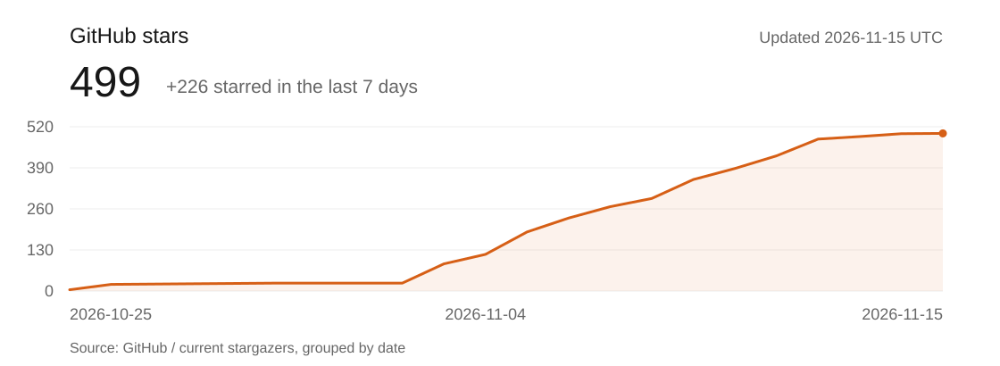

<p align="center">
  <picture>
    <source media="(prefers-color-scheme: dark)" srcset="public/brand/happyhands-logo-paper.png">
    
  </picture>
</p>

<h3 align="center">给编码 Agent 的界面评审与产品体验改进能力。</h3>

<p align="center">抓真实页面、定位真正卡住任务的问题、在隔离工作区里修，然后用前后对比证据判断到底改没改好。</p>

<p align="center">
  <a href="https://happyhands.cc"></a>
  <a href="https://github.com/ShuaiMXu/happyhands/releases/tag/v1.1.0"></a>
  <a href="https://github.com/ShuaiMXu/happyhands/stargazers"></a>
  <a href="docs/harness.md"></a>
</p>

<p align="center">
  <a href="#安装">安装</a> · <a href="#工作方式">工作方式</a> · <a href="#接入你的编码-agent">接入 Agent</a> · <a href="#范围与限制">限制</a> · <a href="https://happyhands.cc">官网</a> · <a href="README.md">English</a>
</p>

HappyHands 是一个本地 Harness，给编码 Agent 一套「可以被追问」的设计评审闭环。它驱动你本机已有的 Chrome 或 Edge 打开真实预览，抓取一个用户任务经过的各种状态，并且只报**有可复现观察**的问题——然后在隔离的 Git 工作区里完成修改，再让一个独立的复核者对着前后证据判断。你可以用命令行驱动，也可以用可选的本地工作台。

https://github.com/user-attachments/assets/19607c8f-3fb4-4db5-826e-ff664980dbce

<sub>37 秒演示：抓取 → 诊断 → 隔离修复 → 独立复核 → 你来决定。</sub>

## 安装

在你想要评审的产品仓库里执行（需要 Node.js 22.15+ 与 npm）：

```sh
npx --yes --package=https://github.com/ShuaiMXu/happyhands/releases/download/v1.1.0/happyhands-lite-1.1.0.tgz happyhands install
```

这条命令安装的是轻量 Skill——运行核心、固定版本方法文件与 8 项运行依赖——默认落到 Codex 的用户技能目录（`~/.codex/skills/happyhands`，或 `CODEX_HOME` 下），不会覆盖已有安装。要装到别的发现路径，加 `--agent claude-code`、`--agent dsh`（`~/.agents/skills`）或 `--scope project`（`.agents/skills/happyhands`）。装完后让 Agent 用 `$happyhands`，给出预览地址和一个具体用户任务即可。详见[轻量版指南](docs/lightweight.md) · [发布说明](https://github.com/ShuaiMXu/happyhands/releases/tag/v1.1.0) · [CLI 参考](docs/harness.md)。

另外还需要 Git、已安装的 Chrome 或 Edge，以及能看截图的模型访问——已登录的 Codex CLI、`--agent claude-code`，或通过 `HAPPYHANDS_API_*` 配置的 API。装上 Skill 本身不代表修复已被验证，一次运行必须过它自己的门禁。

## 工作方式

1. **看清现状。** 连接仓库与预览，确认抓取范围，然后逐个看桌面与手机截图及其问题；切换设备、版本与交互状态不用离开当前评审。
2. **开始修复。** 点 **Fix automatically**：系统会把诊断出的问题对回当前源码，生成范围与方案，在隔离工作区里驱动编码 Agent 执行，再抓取结果、跑适用检查并做一次独立视觉复核。缺失证据和未通过的检查不会被藏起来。
3. **你来决定。** 对比前后，接受或拒绝。拒绝和「要求更多反证」需要写理由。被接受且验证通过的修复，可以通过另一个动作输出成 **draft PR**；HappyHands 不做合并，也不做部署。

一次点击只是代办了范围与方案这两步，不会替你接受结果。没有基线的新界面，在实现之前仍然需要明确的 [Foundation 批准](docs/harness.md)。

### 什么问题才成立

一条上报的缺陷需要有可复现的观察、具体说明哪里不对，并指向它违反的方法快照；Harness 会核对你引用的章节、行号与原文。宽泛建议和审美偏好不会自动进入修复清单。你主动提出的增强，会记录成用户请求，而不会被改写成「观察到的缺陷」。

修复遵循被评审产品自己的设计依据——HappyHands 自己的 UI 规范只作用于工作台，以及明确采纳了它的项目。原始截图、失败的尝试和被排除的建议都留在记录里，包括新反证迫使重新复核、而原失败结论依然保留的情况。见[问题录入与判断依据](docs/finding-admission-policy.md)与 [HappyClaw 反证案例](docs/counter-evidence-review-2026-10-21.md)。

## 接入你的编码 Agent

任何 AI CLI 只要有本机终端、仓库和浏览器访问能力，就能驱动这个 Harness。`harness execute` 会拉起已注册的适配器；用 `--agent self` 时，它只准备好隔离工作区，由当前 Agent 自己改，再通过 `execute-finish` 留下执行记录。默认适配器是 Codex。

| 工具 | 当前角色 |
| --- | --- |
| Codex CLI | 默认实现适配器；内置的看图诊断与复核。 |
| Claude Code | 实现适配器，也做只读诊断/复核（`--agent claude-code`）；仅当设置了 `ANTHROPIC_API_KEY` 时才附加 `--bare`。 |
| 其他任意 CLI | 在 `~/.happyhands/agents.json` 里声明（argv 模板、图片参数、边界声明），即可用于 `execute`、`model-diagnose`、`model-review`。见[适配器文档](skills/happyhands/references/agent-adapters.md)。 |
| Cursor、Kimi Code、WorkBuddy | 跟着 `next` 驱动流程，并用 `--agent self` 自己改；或按上面方式声明适配器。 |
| DeepSeek Harness | `install --agent dsh` 安装；用 `--agent self` 编辑，同样留执行记录。看图评审需要视觉模型——见 [DSH 流程](docs/dsh.md)。 |

`harness agents` 列出已注册的适配器。`--command PATH` 只改二进制路径，不改它的协议。在 Harness 之外做的修改没有执行记录，复核时必须单独标注。

## 范围与限制

HappyHands **免费开源**（MIT）。轻量 Skill 是受支持的入口，工作台是可选项。结论以采集计划和真正跑过的检查为准——没看过的页面、没走到的交互，都算未评审。模型与 CLI 服务可能需要单独的账号或付费套餐。

轻量版运行默认存到 `~/.happyhands/runs`，源码版 CLI 与工作台默认存到 `.harness/`；显式指定输出路径可覆盖。涉及模型的步骤会把选中的源码上下文与图片发给所配置的模型服务。工作区和仓库检查是流程护栏，不是安全沙箱——外发前请先检查导出内容。见[数据与执行说明](docs/local-workbench.md)与[待办缺口](docs/remaining-work-2026-11-12.zh-CN.md)。

<details>
<summary>版本历史与已验证范围</summary>

v1.1.0 是当前正式版；[v1.0.0](https://github.com/ShuaiMXu/happyhands/releases/tag/v1.0.0) 与 [Alpha.4](https://github.com/ShuaiMXu/happyhands/releases/tag/v0.1.0-alpha.4) 仍可下载。升级时用单独的 `--destination PATH`，不覆盖已有安装。

每个版本在自己的发布说明里交代验证范围。简要情况：历史真实产品案例跑在 macOS + Chrome + Codex 上；v1.0.0 的安装包通过过公开下载后的 Windows 冷安装；工程 CI 覆盖 Ubuntu 与 Windows 的 Node 22/24。仍未覆盖：Windows/Ubuntu 上的完整真实产品闭环、完整 Claude-only 或 DSH-only 闭环、真实新使用者接入、跨模型质量对照、真实的 `claude-code` 模型评审，以及真实的 Anthropic/OpenAI 调用（API 适配器目前只有 mock server 覆盖）。视频评审还需要明确可用的 FFmpeg/FFprobe 与真实的整段视听复核。

</details>

## 从源码运行工作台

工作台是同一套 Harness 的本地界面，需要 Git、Node.js **22.15+**、pnpm **11.19** 和 Chrome/Edge。

```sh
git clone https://github.com/ShuaiMXu/happyhands.git
cd happyhands
pnpm install --frozen-lockfile
pnpm workbench
```

保持这个终端不关。`pnpm workbench` 会在本机 **http://127.0.0.1:4190/apps/designer/** 起服务——这不是官网。先确认要评审的产品有可用预览（需要本地服务就在另一个终端按它自己的说明起），再填入仓库目录、预览地址和一个具体用户任务。`DESIGN.md`、tokens 文件这类设计依据是可选的，指向该仓库里已经存在的文件即可。

## 设计资源

[happyhands.cc](https://happyhands.cc) 提供 Design.md 参考、设计系统与组件。轻量入口可以检索这些索引，并把选中的文档冻结进本次运行——包括显式指定的 HTTPS Markdown/CSS/JSON 与 GitHub 文档链接。选中参考不代表安装了组件，也不代表批准了新的设计系统；请先核对来源、用法与许可。

<details>
<summary>Star 增长</summary>

<picture>
  <source media="(prefers-color-scheme: dark)" srcset="assets/readme/star-history-dark.svg">
  
</picture>

按 GitHub 当前 stargazers 及其点星日期聚合；已取消的 star 不计入历史总数。GitHub Actions 每日刷新，图上有快照日期。本地刷新需已登录 GitHub CLI，执行 `node scripts/update-star-history.mjs`——只保存聚合数据；认证或计数失败时保留原图，不会清零。

</details>

## 开发

```sh
pnpm dev             # 本地开发，端口 4173
pnpm design:check    # 设计文档与集成契约校验
pnpm test            # 工程测试
pnpm regression      # 版本化回归用例
pnpm build           # 契约校验 + 生产构建
```

工作台界面在 `apps/designer/`，本地服务在 `packages/workbench/`，抓取、执行与运行记录在 `packages/harness-core/`。本仓库的静态构建不提供可写的本地服务；官网单独维护在 [happyhands-site](https://github.com/ShuaiMXu/happyhands-site)。参与贡献前先读 [AGENTS.md](AGENTS.md)、[DESIGN.md](DESIGN.md) 与[架构](docs/architecture.md)，并且只报告你真正跑过的检查。

## 项目链接

[官网](https://happyhands.cc) · [Harness 指南](docs/harness.md) · [路线图](docs/next-steps.md) · [Issues](https://github.com/ShuaiMXu/happyhands/issues) · [Star 历史](https://www.star-history.com/?repos=ShuaiMXu%2Fhappyhands&type=date) · [Forks](https://github.com/ShuaiMXu/happyhands/forks)

HappyHands 原始代码采用 MIT 许可。随包分发的第三方代码与依赖沿用各自许可，其中 tldraw 另有生产使用要求——见[第三方声明](THIRD_PARTY_NOTICES.md)。
