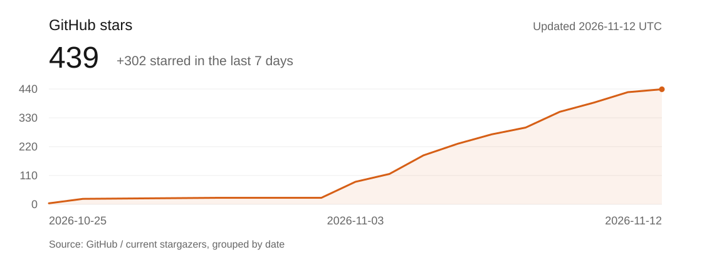

<p align="center">
  <picture>
    <source media="(prefers-color-scheme: dark)" srcset="public/brand/happyhands-logo-paper.png">
    
  </picture>
</p>

<h3 align="center">为编码 Agent 补上 UI 评审与产品体验优化流程。</h3>

<p align="center">从真实页面和用户任务出发，结合设计规范、隔离修改和前后对比改进体验。</p>

<p align="center">
  <a href="https://happyhands.cc"></a>
  <a href="https://github.com/ShuaiMXu/happyhands/releases/tag/v1.0.0"></a>
  <a href="https://github.com/ShuaiMXu/happyhands/stargazers"></a>
  <a href="docs/harness.md"></a>
</p>

<p align="center">
  <a href="#开始使用">开始使用</a> / <a href="#一次审阅怎么进行">审阅流程</a> / <a href="#star-增长">Star 增长</a> / <a href="https://happyhands.cc">官网</a> / <a href="README.md">English</a>
</p>

HappyHands 帮助编码 Agent 检查界面设计、信息层级、交互反馈和任务流程。使用本地 Harness 采集真实页面，在隔离工作副本中修改，再对照前后证据判断结果。可通过命令行操作，也可使用本地工作台。

## 产品演示

37 秒产品演示。

https://github.com/user-attachments/assets/19607c8f-3fb4-4db5-826e-ff664980dbce

[v1.0.0 正式版](https://github.com/ShuaiMXu/happyhands/releases/tag/v1.0.0)已发布，提供安装包、源码清单与校验值，并已通过公开下载后的独立冷安装验证。

## 开始使用

在你的产品仓库中，一行安装 **已发布的轻量 v1.0.0 Skill**，无需启动工作台：

```sh
npx --yes --package=https://github.com/ShuaiMXu/happyhands/releases/download/v1.0.0/happyhands-lite-1.0.0.tgz happyhands install
```

默认安装到 Codex 用户技能目录（`~/.codex/skills/happyhands`，或 `CODEX_HOME` 下），不改产品源码。`--scope project` 可安装到项目内的 `.agents/skills/happyhands`，隔离修复前需要先提交或忽略这些安装文件。包内包含运行核心、完整的固定版本方法文件和六项运行依赖；已有 Skill 不会被覆盖。在 Codex 中使用 `$happyhands`，提供预览与一个具体用户任务，或按[轻量版指南](docs/lightweight.md)调用。`install --agent claude-code` 可安装到 Claude Code 的发现目录，其完整执行闭环仍未验证。DSH 可作为外部操作端读取和调用。

需要 Node.js 22.15+（含 npm）、Git、Chrome/Edge 和已配置的 Agent。内置模型诊断与复核使用 Codex，新模型需使用支持它的 Codex 版本。安装和选取参考资料不代表真实产品修复已通过验收；包本身的实际验证与限制见 [v1.0.0 发布说明](https://github.com/ShuaiMXu/happyhands/releases/tag/v1.0.0)。历史 [Alpha.4](https://github.com/ShuaiMXu/happyhands/releases/tag/v0.1.0-alpha.4) 继续保留；升级时使用单独的 `--destination PATH`，不覆盖已有安装。

首版覆盖本地证据与修复流程、所选 Design.md/设计系统参考，以及独立的视频时间线审阅流程。历史真实产品案例使用 macOS、Chrome 和 Codex。本版另有 Windows 安装包冷安装验证与 Ubuntu/Windows 工程 CI；这些平台的完整真实产品闭环、完整 Claude-only 或 DSH-only 闭环、真实新使用者接入及跨模型质量对照仍待验证。视频流程还需要明确可用的 FFmpeg/FFprobe 与真实整段视听复核。版本号不会将未测环境或未查看状态变成通过结论。

### 可选的本地工作台

下方保留源码工程与可视化工作台的使用方式；完整命令见 [Harness 指南](docs/harness.md)。

准备 Git、Node.js **22.15+**、pnpm **11.19**，以及用于浏览器采集的已安装 Chrome 或 Edge。本仓库提供本地工作台与 Harness 源码。工作台内置模型诊断和视觉复核需要已配置、已登录的 **Codex CLI**；代码实现所需的 CLI 配置取决于所选执行器。区别见[配合你的编码工具](#配合你的编码工具)。

```sh
git clone https://github.com/ShuaiMXu/happyhands.git
cd happyhands
pnpm install --frozen-lockfile
pnpm workbench
```

保持这个终端运行。`pnpm workbench` 会启动 **HappyHands 本地工作台**，并打开 **http://127.0.0.1:4190/apps/designer/**。这个地址需要启动服务后才能在你的电脑上访问，不是官网，也不是主题工作室。

确保待审阅产品有可用的预览。如果需要本地服务，请另开一个终端，按照该项目自身的说明启动。确认预览地址能在浏览器中打开后，再到 HappyHands 工作台连接项目，提供本地仓库目录、预览地址和具体的用户任务。

下面是需要提供的信息示例，**不是终端命令**。请将目录和地址替换为项目的实际值；`3000` 只是示例端口，与工作台使用的 `4190` 不同。

```text
项目仓库：/path/to/your-product
预览地址：http://localhost:3000
用户任务：完成注册并创建第一个项目
已有设计资料（可选）：DESIGN.md、src/styles/tokens.css、src/components
```

设计资料是待审阅仓库中已有的规范文件、样式或组件目录，供审阅参考。上面的路径只是示例，并非必须具备的文件；请使用实际路径，没有的可以省略。

采集前核对建议的页面、设备和交互状态。项目配置和命令行操作见 [Harness 指南](docs/harness.md)。[官网](https://happyhands.cc) 提供使用指引和设计资源；仓库审阅和代码修改在本地执行。

## 一次审阅怎么进行

1. **查看问题。** 连接仓库和预览，核对采集范围，查看桌面、手机截图及对应问题。在当前审阅中切换设备、版本和交互状态，点击截图即可页内放大。
2. **一键修复。** 工作台根据当前源码核实诊断问题，准备修改范围和计划，再调用编码 Agent 在隔离的 Git 工作副本中执行。完成后重新采集页面，运行适用检查和独立视觉复核。缺失证据和失败记录会保留。
3. **核对结果。** 查看前后对比，决定接受或拒绝。接受时理由选填；拒绝或提交反证重新复核时需说明原因。已接受且通过验证的修复，可再点击提交**草稿 PR**，工作台不会替你合并或部署。

一键修复代表你授权工作台处理本轮中间的范围与计划步骤，最终结果仍由你判断。没有原页面的新界面，依然需要先明确批准[设计基础](docs/harness.md)，再开始实现。

### 问题需要什么依据

正式问题需要有可复现的现象、明确的错误说明，以及对应的 skill 快照引用。Harness 会核对引用的章节、行号和原文。宽泛的设计建议、个人审美偏好不能单独成为自动修复依据。

用户明确要求的改进按真实请求记录，不伪装成已观察到的缺陷；执行仍须遵循项目规范、绑定源码与范围、隔离修改，并进行新的独立复核。

修改遵循被审项目自己的设计来源。HappyHands UI 规范用于工作台，以及明确采用这套规范的项目。原始截图、早期失败和未录入建议都会保留，具体要求见[问题录入与判断依据](docs/finding-admission-policy.md)。

[HappyClaw 重审记录](docs/counter-evidence-review-2026-10-21.md) 展示了一次实际过程：补充反证后重新独立复核，同时保留原失败报告。这份记录说明的是该案例的审阅路径，不代表整个产品已验收或部署。

### 设计资源

[官网](https://happyhands.cc) 提供 Design.md 参考、设计系统和组件资源，可结合任务选择设计来源，并核对源码、使用方式与许可。轻量入口可检索索引，将选中的完整文档冻结到同一条运行记录，也支持明确选择的 HTTPS Markdown/CSS/JSON 与 GitHub 文档链接。选取参考不会安装组件或批准新的设计系统；后续真实案例验收见 [#7](https://github.com/ShuaiMXu/happyhands/issues/7)。

## 配合你的编码工具

HappyHands 支持任意 AI CLI 参与开放的编码 Agent 工作流。外部 Agent 具备所需的本地终端、仓库和浏览器访问能力时，可以操作 Harness；在 Harness 外完成的修改也可采集和审阅。通过 `harness execute` 直接执行则需要已注册的适配器，当前默认使用 Codex。这不代表每个 CLI 都有内置接入，也不代表所有功能都已在每个 CLI 上验证。

| 工具 | 当前用途 |
| --- | --- |
| Codex CLI | 内置模型诊断、截图视觉复核，也是默认代码执行适配器；执行路径已有使用记录，不等于所有功能均已完成全流程验证。 |
| Claude Code | 对已确认任务提供代码执行适配器；需先完成配置，完整端到端验证仍待完成。 |
| Cursor、Kimi Code、WorkBuddy | 工具具备本地浏览器、终端和仓库访问能力时，可以指导和操作 Harness；目前没有各自的代码执行适配器。 |
| DeepSeek Harness（DSH） | 可在 DSH 对话中调度已有 CLI；尚无专用执行适配器，内置模型诊断与复核仍需 Codex。见 [DSH 调用流程](docs/dsh.zh-CN.md)，包含 headless 的认证限制。 |

运行 `pnpm harness agents` 查看已注册执行器，通过 `harness execute --agent ID` 选择；`--command PATH` 只更改该适配器的二进制路径，不改变 CLI 协议。其他 CLI 若要直接执行，需要添加适配器。外部修改没有 Harness Agent 执行记录，审阅时需单独说明。具体行为和限制见[适配器说明](docs/architecture.md#agent-adapters-and-the-permission-boundary)。

## 当前范围

HappyHands **免费开源**。v1.0.0 是轻量本地 Skill 的正式版本，源码工作台仍为可选入口。外部模型和 CLI 服务可能需要单独的账号、订阅或按量付费。结论以采集计划和已完成检查为准，未查看的页面、未测试的交互仍属未审阅范围。专业校准、新使用者验证、云端检查等缺口见[剩余待办](docs/remaining-work-2026-11-12.zh-CN.md)。

轻量入口的运行记录默认存放在 `~/.happyhands/runs`，源码 CLI / 工作台仍使用 `.harness/`；也可显式指定输出路径。模型辅助步骤会通过 CLI 将所选源码上下文和图片发送给配置的模型服务。工作副本与仓库检查属于流程保护，不是安全沙箱。分享导出记录前应检查敏感内容，详见[数据与执行说明](docs/local-workbench.md)。

<details>
<summary>开发与仓库说明</summary>

```sh
pnpm dev             # 本地开发，端口 4173
pnpm design:check    # 设计文档和接入契约检查
pnpm test           # 工程测试
pnpm regression     # 版本化发布案例
pnpm build          # 契约检查及生产构建
pnpm harness skills # 已注册方法及其成熟度
```

工作台界面位于 `apps/designer/`，本地服务位于 `packages/workbench/`，采集、执行和运行记录位于 `packages/harness-core/`。当前公开官网由 [happyhands-site](https://github.com/ShuaiMXu/happyhands-site) 独立维护；本仓库的静态构建不提供可写本地服务。

贡献前阅读 [AGENTS.md](AGENTS.md)、[DESIGN.md](DESIGN.md) 和[架构文档](docs/architecture.md)。保留批准边界、来源信息及完整上游 Skills，如实记录实际执行的检查；不要提交凭证、私有截图或本地运行记录。

</details>

## Star 增长

<picture>
  <source media="(prefers-color-scheme: dark)" srcset="assets/readme/star-history-dark.svg">
  
</picture>

增长图按 GitHub 当前 Star 用户的加星日期累计，无法还原取消 Star 之前的历史总量。GitHub Actions 每天刷新图表，更新时间显示在图中。顶部徽章显示当前总量。

<details>
<summary>刷新增长图表</summary>

配置并登录 GitHub CLI 后，在仓库根目录运行：

```sh
node scripts/update-star-history.mjs
```

脚本仅保存每日汇总与图表，不保存用户名或凭据。认证、数据或数量校验失败时保留原图，不将失败结果写成零。数据文件：[star-history.json](assets/readme/star-history.json)。

</details>

## 项目链接

[官网](https://happyhands.cc) / [Harness 指南](docs/harness.md) / [待办](docs/next-steps.md) / [问题反馈](https://github.com/ShuaiMXu/happyhands/issues)

关注核心项目：

[](https://github.com/ShuaiMXu/happyhands/forks)
[Star history](https://www.star-history.com/?repos=ShuaiMXu%2Fhappyhands&type=date)

自有 HappyHands 源码采用 MIT。第三方代码和依赖保留各自许可，包括 tldraw 独立的生产使用要求，详见 [第三方声明](THIRD_PARTY_NOTICES.md)。
