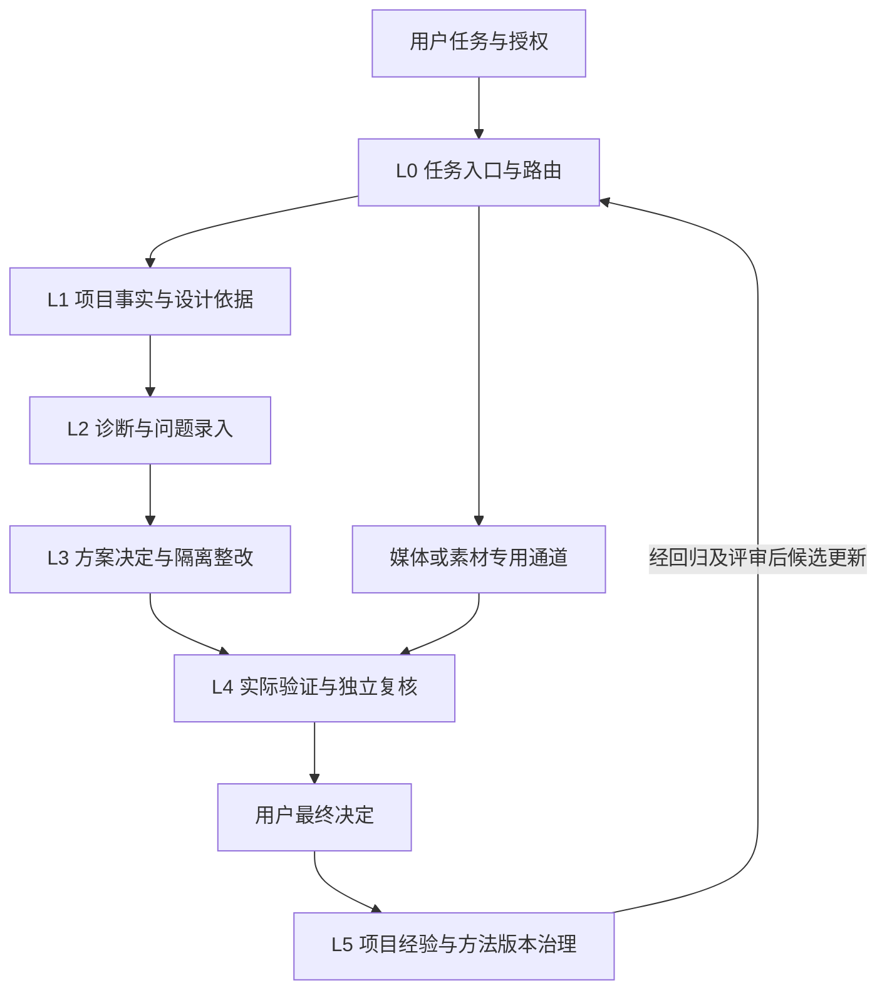

# HappyHands Skill 结构与淘汰、改写框架

审阅日期：2026-11-14。源码基线：`8fcaf634386582406336a3f580c977d1af43c0ee`。状态：本文件保留审阅基线和判断；运行时落地及验证边界见 [实施记录](implementation.zh-CN.md)。未删除历史 Skill，也未以本次代码检查冒充真实任务验收。

## 1. 本轮范围和实际结论

审阅工程 `skills/` 下 50 个受版本控制的 Skill 入口，并核对注册清单、处理器、方法加载路线、阶段交付与验收约束。宿主个人技能目录不属于本轮产品分发范围，不能因为本机安装了某个 Skill 就声称 HappyHands 已提供该能力。

| 类别 | 数量 | 本轮审阅 |
| --- | ---: | --- |
| 工程入口、执行协议、自有界面配置及视频流程 | 5 | 职责、交付和边界 |
| product-design 注册能力 | 27 | 全部 Skill 契约、manifest、处理器映射及关键实现 |
| 其中 bounded | 18 | 有界实现；不等于专业判断或产品验收完成 |
| 其中 contract-only | 9 | 统一 evidenceGate，不存在专用自动执行实现 |
| 第三方 Skill 入口 | 18 | 逐入口的用途、适配、默认/兼容/素材路线及权限冲突 |

逐项决定见 [50 项审阅清单](catalog-2026-11-14.zh-CN.md)，路径、版本、哈希和 requiredInputs 见 [机器清单](catalog-2026-11-14.json)。第三方 18 项做的是入口和接线路径审阅；全部参考文档、模板、素材及脚本没有逐行审计，也没有执行 50 个真实任务。本轮不把入口覆盖率称为效果验证。

主要结论：现有问题不是 Skill 数量不足，而是方法、静态线索、实际执行与质量判断混用。部分专业接口只有很薄的检查器或占位处理器；完整保存厂商文件解决来源问题，尚不能解决任务选择和执行效果问题。

## 2. 六层职责



| 层 | 唯一职责 | 主持者/方法 | 现有承载物 | 失败或未知如何处理 |
| --- | --- | --- | --- | --- |
| L0 | 任务、表面类型、范围、授权与方法选择 | happyhands；review-product 作为既有产品模式 | Experience Spec.project、项目配置、Run | 未知事实标注，材料不足只补真正缺口 |
| L1 | 记录已有品牌、token、组件、消费者、实际设计来源 | Foundation/brand/component inventory；OJO 及项目文档辅助 | Foundation、设计来源快照、组件图 | observed 不变 approved，静态可达不变已渲染 |
| L2 | 识别任务障碍，区分缺陷、请求、假设、偏好 | 专业审阅 + Impeccable Audit/Critique | experienceAudit、diagnosis、findingBasis | 无实际缺陷证据不进入自动缺陷修复 |
| L3 | 对问题选方案，比较保留/更轻方案，隔离实施 | fix/reuse planner、experience-remediation；按问题选择具体方法 | designDecision、plan、execution result | 错方案可退回决定；不为完成清单制造修改 |
| L4 | 复拍、实际交互、受影响消费者、独立结论 | QA、component-state、a11y、responsive；浏览器及项目测试 | verification、evaluation、visualReviews | 脚本 complete、结构 pass、体验 pass 分别归因 |
| L5 | 保留人类判断、案例、反例、适用性与版本 | judgment、case、pattern、expertise、regression | 既有 memory/case/release 机制 | 候选不自动晋升；可撤回、降级和回滚 |

Harness 是这六层的状态、权限、来源与交付管理者；Skill 是被选择的方法或检查器。浏览器、代码执行器、模型会话、渲染器、测试框架是执行能力，不应伪装成另一项设计 Skill。

## 3. 第三方方法的准确位置

| 方法 | 应负责 | 不应负责 |
| --- | --- | --- |
| Impeccable | 产品语境、技术审计、体验批评、专项整改、打磨 | 单独接管源码授权、最终接受、发布或项目品牌决定 |
| OJO | 设计系统、组件状态、图标、间距、视觉尺度、动效的具体依据 | 强制通用网格/参数/三选一流程，覆盖项目实际规范 |
| web-taste | 用户已指定的公开页面设计主方法；构图、内容与视觉方向 | 将官网节奏、图片数量、装饰规则普遍强加给工作台 |
| 历史 Taste 与风格变体 | 精确历史回放或明确选择的方向 | 默认同时加载并执行多个互斥审美 |
| 图像/品牌/Stitch 方法 | 明确的素材、概念或重建任务 | 用生成图代替产品基线、实际界面或批准的 Foundation |

Impeccable 当前 review 先读 Audit/Critique；implementation 先读 Polish，intent 仅支持 polish/layout/animate。Harden、Distill、Typeset、Clarify 等虽在包内，却没有同等明确的 profile 路由。应补充任务方法选择，不能把“完整文件已复制”描述为“所有方法已经执行”。其原生 context/detect/live 工具目前未自动启用；后续接入应单独核查版本、工具许可、输出绑定和副作用。

在本次分类中，还应区分用户目标：决策/宣传、操作、阅读、作品体验。这是建议的语义标签，不是当前 CLI 已支持的新枚举。当前实际 surface 仍为 public-page/app-screen；视频用独立通道。表面语义可以细化，既有运行格式不能被文档直接改写。

## 4. 排除、改写与保留清单

“排除”优先指退出默认决策和执行路线。保留原文件、许可与版本，兼容历史 Run；不通过删除证据证明系统变简洁。

### 4.1 退出默认执行，保留归档/显式使用

- 历史 Taste v1、旧 v2、v2-experimental、独立 taste-v2 快照：仅兼容和历史对照。当前已存在 legacy-v2/dials-v1 显式路线，不能破坏旧用户；不增加这些路线的默认权重。
- brutalist、soft、minimalist、gpt-taste：都是带具体偏向的方向候选。固定 AIDA、巨大间距、随机构图、强制滚动动效、终端装饰等不能作为通用质量要求。用户明确采用方向时才使用适用部分。
- image-to-code、imagegen web/mobile、brandkit、stitch：退出普通缺陷修复默认路线；仅在实际素材/图像/品牌/重建任务有意义时使用。其工具前提、成本、素材权利与结果类别需单列。
- output-skill：只是输出辅助，不能提升成设计判断或越过宿主限制。

这些项目多数已经不在默认 first-read；本轮通过运行时选择及结果 capability 明确“可用但未选中”，避免因为文件存在被模型混用。不能仅凭某风格与 HappyHands 不同就把它称为普遍低质量。

### 4.2 从“可执行专业能力”降为方法契约/待实现

以下九项 manifest 已为 contract-only，处理器均是 evidenceGate：

| 能力 | 应如何处置 | 优先级 |
| --- | --- | --- |
| error-recovery-reviewer | 作为异常路径方法交给真实操作/模型；未接实际状态证据前不称执行完成 | P1 |
| change-impact-mapper | 接 source-bound diff 与消费者图，记录动态依赖未知项 | P1 |
| incremental-review-router | 依赖可靠 impact map，给出检查选集及排除理由 | P1，晚于 impact |
| token-normalizer | 基于 Foundation 输出可否合并的语义提案，不自动改 token | P2 |
| trust-conversion-reviewer | 按决策任务读取；不能声称有转化提升测量 | P2 |
| regression-case-author | 连接现有案例收集/准入服务，先检查脱敏和证据资格 | P2 |
| skill-regression-evaluator | 接现有 regression 工具，不另建平行分数系统 | P2 |
| expertise-candidate-author | 多案例支持后才写通用原则候选 | P3 |
| experience-score-calibrator | 保持研究态；无校准数据不提供总分 | P3 |

`packages/skill-core/runner.js` 目前把 gitDiff/regressionCases 固定为 false，projectHistory 只为 pattern curator 取专用数据；evidenceGate 也将这些输入标为 false。结果是对应 ID 不能因调用成功就被算作已经完成影响分析、路由或学习。其他 Harness 服务可能已有相应能力，不等于这些 Skill 接口已接通。

### 4.3 改写有实现但能力名称过宽的交付说明

| 入口 | 实际处理器边界 | 改写后的明确责任 |
| --- | --- | --- |
| IA reviewer | landmark、标题级别线索 | 静态结构检查 + 另行导航任务审阅 |
| interaction reviewer | 可访问名称等 DOM 线索 | 静态控件检查 + 真实状态转移验证 |
| content reviewer | 常见模糊标签匹配 | 字符串筛查 + 任务语义/事实审阅 |
| hierarchy reviewer | H1/动作计数及 rubric | 准备视觉候选；原图批评由有图像输入的会话完成 |
| fix planner | proposal/批准约束草稿 | 候选约束整理；设计决定由现有 experience decision 保存 |
| visual QA | 前后证据配对 | 证据准备；真正独立 QA 在 ai-review/attest 流程完成 |

保留现有 ID，优先修正用户可见能力描述与结果类型。不是把薄处理器换个更漂亮的 Skill 文案就算补齐功能。

### 4.4 合并产物，保留必要专长

- IA、交互、内容、视觉层级、Impeccable Critique：共用一个 audit/problem register，避免同一问题报五遍；不同证据和专业判断保留。
- consistency 与 drift：共享 token/source scan；区分无规范的重复线索与违反已采用规则的偏差。
- Foundation、brand、component inventory：共享源码快照，分别记录品牌含义、视觉值和组件语义，不互相代签批准。
- fix/reuse planner + Shape/Layout：汇入一个 designDecision，不增加四次用户确认。
- product QA、可访问性、响应式：分别提供证据与局部结论，最终由独立复核汇总；完整任务证据不足不能被局部通过覆盖。

## 5. 审阅发现的结构问题

以下是源码/文档接线问题和风险，不是对某页面新录入的 UX Finding。

| ID | 证据位置 | 判断与处理 |
| --- | --- | --- |
| A1 | skill-core/registry.js；27 个 skill.json；handlers.js/evidenceGate | 9 个接口只有契约。公开能力目录须显示 provider 与边界，不得用调用次数声称已具备专业能力。 |
| A2 | skill-core/design-guidance.js/readingRoute | 默认执行范围主要是 Audit/Critique/Polish+intent，专项路由不完整。补实际问题→方法映射。 |
| A3 | skill-core/runner.js；handlers.js 中 IA/interaction/content/hierarchy | 静态线索被专业名称包装。模型审阅和实际操作必须另列 provider/result。 |
| A4 | review-product、happyhands、experience-remediation、fix-planner 的 handoff 段落 | 多处重复描述状态协议，后续改写容易不一致。规范归入公共协议，Skill 保留专属判断。 |
| A5 | vendor/taste 与 vendor/taste-v2 内多个 design-taste-frontend name | 名称不唯一，且旧快照含强风格约束。以包/路径/revision 唯一标识，显式选择，禁止模糊默认。 |
| A6 | skill-core/design-guidance.js 的 metadata/readFirst；experience audit methods | 文件快照、引文和应用描述证明来源，不能证明任务效果。结果必须指向具体原图、动作、改动和独立反证。 |
| A7 | docs/architecture.md；docs/experience-orchestration.md | 架构仍有旧多确认流程/“领域不是视频”表述；orchestration 提到 29 checks，而当前 rules.json 为 33。需要按当前实现更新，不能复制旧数字。 |
| A8 | review-video/SKILL.md 中 18 秒个案；happyhands-ui 的基础/追加规则 | 个案与通用协议混放，规则有重复。拆案例/profile引用；保留用户约束和旧版本，避免全局强制。 |
| A9 | experience-orchestration.js；workflow.js；文档兼容声明 | 新 start/continue 与 legacy init/onboard/workbench 的体验审计门槛不同。显示当前 policy 与可用下一步；不能声称所有入口都跑了新版闭环。 |
| A10 | 当前 50 项目录与 remediation rules | 过去讨论过的排版细则、Dashboard 专项并无独立完整契约及 provider；Hero 有自有条件规则。后续路线表若写到专项，必须标“待补”，不能说已经有完整实现。 |

## 6. 单次任务如何组装

每次只确定一个关键任务和主要修改方向，按影响范围补专业检查。不要为“全 Skill 都用上”生成无关问题。完整方法文件按需读取；压缩重复协议不能改写/截断厂商原始文件。

| 场景 | 主方法 | 按证据追加 | 必需的实际验证 |
| --- | --- | --- | --- |
| 下拉菜单遮挡 | 项目组件依据 + Harden | OJO component/icon、a11y | 长标签、打开/选择/禁用、键盘、Escape、焦点、消费者 |
| 工作台流程复杂 | 任务/IA/interaction + Critique；Shape/Distill/Layout 决定 | 项目组件、文案、错误恢复 | 从进入到任务完成；被合并/移除步骤的后果；原稿也可胜出 |
| 官网 Hero | 已指定 web-taste + 项目品牌/内容 | OJO、必要的 Impeccable 表达方法；自有 Hero 规则条件适用 | 实际动态/静态、读写操作、两主题与受影响设备；不能用静止图证明动效 |
| Dashboard | 业务任务、数据定义、IA + Critique/Layout | OJO tokens/components、state/contrast | 筛选、空/错/加载、密度与阅读任务；独立 Dashboard 合约待补 |
| 文字排版 | 项目语言/字体/排版需求 + 适用 Typeset | 文案、a11y、语言和溢出 | 标题/段落断行、混排、变动数字、截断及完整内容访问；专项契约待补 |
| 视频 | review-video + 原工程制作方法 | 实际需要的资产/动效方法 | 前后整片、全音轨、时间码与独立完整视听；页面 QA 不替代 |

### 建议的统一选择记录

复用现有 audit/decision/plan/result。以下是字段设计示例，不是可直接传给当前 CLI 的新参数或已实施 schema：

```json
{
  "task": "选择配送方案并确认下一步",
  "surface": "app-screen",
  "policy": "task-design-review@1",
  "selectedMethods": [
    {"entry": "impeccable/reference/critique.md", "phase": "diagnosis", "reason": "检查方案与主操作的阅读关系"},
    {"entry": "impeccable/reference/layout.md", "phase": "implementation", "reason": "调整已获授权的信息分组"}
  ],
  "checks": [{"provider": "browser", "state": "方案菜单打开", "expected": "可区分名称、键盘选择并返回焦点"}],
  "excludedMethods": [{"entry": "gpt-taste", "reason": "未请求营销重设计或滚动动效"}],
  "outputs": ["当前任务证据", "设计决定", "差异", "匹配复拍", "独立结论"]
}
```

方法身份使用完整路径、revision/hash 和阶段。对用户只展示确实执行的行为和问题结果；无需把内部方法清单塞进产品操作界面。

## 7. 每次改写怎样自进化

### 触发条件

真实任务中出现误报、漏报、错路由、无效修改、体验退化、重复步骤或工具不适配。单纯“用了几次”与模型自我打分不构成进化依据。宽泛、无输入、无动作或不可证伪的指令先降级，不继续增加形容词。

### 改写记录

每次绑定：问题和任务来源、旧 Skill/provider 版本与哈希、实际输入及原失败、新旧差异、预期改善、适用范围、例外、验证方法、未完成项。方法文案与 provider 的变化分别记录，未实现的行为不能通过改文案宣称完成。

### 晋升过程

```text
任务失败/人类判断
→ 有证据的局部候选
→ 最小方法或 provider 改写
→ 原失败案例 + 合理反例 + 受影响回归
→ 必要的真实任务对照和独立评审
→ 发布新版本/只在项目采用/继续观察/撤回
```

至少覆盖原问题和一个应保留原状的反例，并检查实际受影响消费者。若声称改善设计质量，还要有真实匹配任务、原图和判断；纯合成测试只能验证协议。模型和工具配置、人工介入、耗时及已知输入差异要记录，不宣称不公平对照证明模型提升。

新版本不覆盖旧 Run 的快照。不因单次拒绝得出“永远不用表格/渐变/某字体”；反例可以推翻改写。重复无效、误报或高成本低收益时，标记降级/退出默认；恢复默认也需新证据。涉及发布、合并及权限仍遵循当次用户授权。

### 五种治理决定

| 决定 | 使用条件 | 后果 |
| --- | --- | --- |
| 保留 | 职责、输入、动作、结果与验证相符 | 保留方法；调用仍需任务适用 |
| 改写 | 能力有价值，但泛化、语义或 provider 不匹配 | 改具体输入与可证伪结果，补回归 |
| 并入 | 与另一方法重复工作或重复产物 | 共用输入/结果，保留 ID 兼容与专属依据 |
| 退出默认 | 风格预设、未实现接口、反复误报、无适用任务 | 不参与普通自动修复；明确选择或证据补齐才使用 |
| 历史归档 | 为旧案例、许可证或行为兼容保留 | 可读取/回放，不替代当前默认方案 |

## 8. 推荐实施顺序与退出条件

1. **先让目录诚实。** 区分方法可用、静态检查、真实操作、模型判断、独立复核、人类决定；纠正文档数字及旧流程，明确九个 contract-only 的状态。产物是能力目录与可核对的 provider 链。
2. **再做方法选择与结果交付。** 复用现有配置、audit、decision 与逐项执行结果；补 Harden/Distill/Typeset/Clarify 等任务路由和排除理由。不得新增一套总工作台或每方法审批。
3. **跑一个真实工作台任务。** 先看正常工作页面与展开状态，再共享组件、完整路径、其他设备。保留合理原设计；允许结论为不修改。实际独立 QA 与人类判断缺失时不称完成。
4. **补最有价值的 provider。** 先 recovery，再 impact/router；学习和总分后置。每个改写按第 7 节版本化与验证。
5. **最后精简协议与案例。** 合并重复 handoff，抽出自有 UI profile 和视频个案，锁定厂商版本；不破坏历史哈希和已接受的项目例外。

以上清单记录框架审阅阶段结论。已落地的方法选择、契约改写及演进发布校验见 [实施记录](implementation.zh-CN.md)；九个占位分析器仍未实现，框架审阅本身不证明视觉质量改善。

## 真实案例验证

[项目方法设置案例](case-method-settings.zh-CN.md)记录了真实诊断、隔离修复、匹配复拍、配置保存及独立复核，并区分方法读取、实际应用和证据缺口。该案例的整体复核仍为 needs-evidence，人工接受待定，不作为已接受的学习样例。
