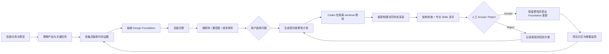
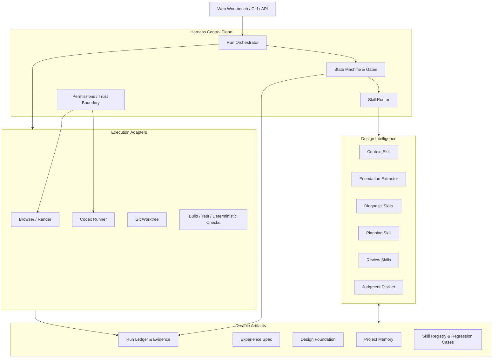
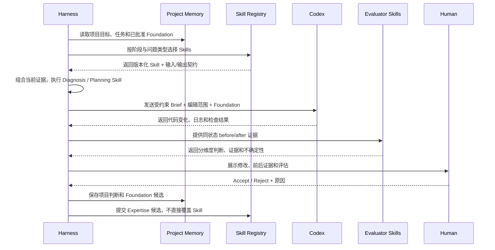
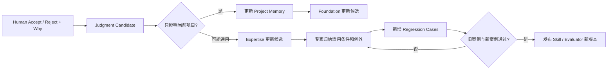

# Product Designer Harness：完整流水线与 Skills 架构

本文把产品分成四个不同概念，避免把它们都叫作 Agent：

- **Harness** 是控制器，决定流程、状态、门槛和证据是否齐全。
- **Skills** 是版本化的专业能力，负责某一种设计判断或产出。
- **Codex** 是代码执行器，在受约束的工作区里实现选定方案。
- **Project Memory / Design Foundation** 是项目长期资产，保存产品上下文与已批准规范。

Skills 不负责控制整个系统，也不应该自己修改全局记忆。Harness 选择 Skill、准备输入、校验输出，并决定能否进入下一步。

## 1. 用户看到的完整流水线



一次运行只解决一个明确问题。完整诊断可以发现很多问题，但不能一次把所有问题交给 Codex。这样前后变化才可归因，也容易回退。

### 首次接入

1. 用户提交仓库、可访问的预览地址、产品目标和最关键的用户任务。
2. Harness 固定源代码版本、运行环境、页面状态和桌面/手机视口。
3. Evidence Collector 采集页面截图、DOM、主要操作、构建状态和相关源文件。
4. Foundation Extractor 盘点品牌、Token、组件、变体、状态和交互模式。
5. Diagnose Skills 从各自专业角度产出带证据的 Findings。
6. Priority Engine 给出排序和原因，用户确认首先解决的问题。

### 修改与验证

1. Harness 确认 Finding 与当前基线仍然匹配；过期证据标记为 `stale`。
2. Planner Skill 将 Finding、证据和已批准的 Design Foundation 编译成修改计划。
3. Codex Runner 创建隔离 Git worktree，传入限定范围的 Brief。
4. Codex 优先复用已批准的 Token 和组件，修改代码并执行必要检查。
5. Browser Runner 在相同状态和视口重新渲染。
6. Deterministic Evaluator 检查加载、布局溢出、标题和其他确定性条件。
7. Review Skills 复查任务清晰度、层级、品牌一致性、交互、无障碍等专业维度。
8. 人工 Accept / Reject 并记录原因；系统不能用自动分数替代这个决定。

### 持续阶段

1. Git 变更触发 Impact Mapper，定位受影响页面、组件和关键任务。
2. Harness 只重跑相关证据和 Evaluator，形成增量 UX Review。
3. 被接受的新 Token、组件或模式成为 Design Foundation 更新候选。
4. 反复出现的人类判断成为 Expertise 更新候选。
5. 候选先经过审核和回归集验证，再发布新的 Foundation 或 Skill 版本。

## 2. Harness 内部架构



### Control Plane

`Run Orchestrator` 按阶段推进运行。`State Machine` 阻止跳步，例如没有有效基线不能计划修改，Finding 未确认不能执行，前后视口不一致不能得出对比结论。`Skill Router` 根据当前阶段、产品类型和 Finding 类型选择少量相关 Skills。`Policy` 限定仓库、浏览器、凭证、推送和部署权限。

### Execution Adapters

Browser 负责采集和渲染；Git Worktree 提供隔离；Codex Runner 负责代码修改；Build/Test 负责确定性验证。它们执行动作，不负责判断“设计是否更好”。

### Durable Artifacts

| 资产 | 保存内容 | 生命周期 |
| --- | --- | --- |
| Project Memory | 用户、任务、商业目标、技术栈、历史决定 | 项目长期 |
| Experience Spec | 本轮证据、Findings、优先级、方案和判断 | 每次 Review 可版本化 |
| Design Foundation | 品牌、Token、组件、模式及治理状态 | 项目长期、持续更新 |
| Run Ledger | 截图、日志、Commit、前后评估和错误 | 每次运行不可静默覆盖 |
| Skill Registry | Skill 版本、适用条件、Evaluator 和回归案例 | 产品全局或行业范围 |

## 3. Skills 在每个阶段怎样运作



### Skill 的标准契约

每个 Skill 都应该有清楚的适用范围和机器可校验输出：

```text
Skill Manifest
├── id / version
├── role                   # diagnose / plan / review / distill
├── applies_when           # 产品类型、页面、Finding 类型
├── required_inputs        # 任务、证据、Foundation、before/after
├── output_schema          # Finding、Plan 或 Evaluation
├── rubric                 # 判断维度和通过条件
├── examples               # 正例、反例、例外
├── evaluator              # 如何验证这个 Skill 的输出
└── regression_cases       # 升级时必须保持的案例
```

Skill 的输入由 Harness 提供，不能自己猜测缺失上下文。例如 Visual Hierarchy Skill 至少需要目标任务、当前页面状态和截图；Component Consistency Skill 还需要 Design Foundation。输入不足时，输出应是 `needs-evidence`，而不是编造结论。

### 推荐的 Skill 分组

| 阶段 | Skills | 主要输出 |
| --- | --- | --- |
| Context | Product Context、Critical Task Mapper | 用户、目标、关键任务、约束 |
| Foundation | Brand Extractor、Token Miner、Component Inventory、Pattern Auditor | Design Foundation 草稿与不一致项 |
| Diagnose | IA、Visual Hierarchy、Interaction、Content、Accessibility、Responsive、Trust | 带证据的 Findings |
| Prioritize | Impact Estimator、Confidence Calibrator、Effort Estimator | 可解释排序 |
| Plan | UX Fix Strategist、Component Reuse Planner | 修改方案、范围、验收标准 |
| Review | Task Evaluator、Visual QA、Consistency Checker、Accessibility Evaluator | 分维度前后判断 |
| Learn | Judgment Distiller、Regression Author | Expertise 候选与回归案例 |

Skill Router 不会每轮运行所有 Skill。首页首屏问题可能调用 Context、Visual Hierarchy、Content、Brand Consistency 和 Responsive；复杂表单会更多调用 Interaction、Content、Accessibility 和 Error Recovery。这样成本、延迟和相互冲突都更可控。

## 4. Skills、Design Foundation 和 Evaluator 的区别

| 概念 | 回答的问题 | 例子 |
| --- | --- | --- |
| Skill | 专业上应该怎样判断或行动？ | “如何判断首页层级是否支持关键任务” |
| Design Foundation | 这个项目已经批准了哪些具体规则？ | `PrimaryButton`、品牌青色、标题字号 |
| Evaluator | 这次输出是否满足标准？ | 主操作是否更清楚、是否产生不一致 |
| Project Memory | 这个项目过去发生过什么？ | 用户拒绝 Modal，因为任务需要不中断 |
| Harness | 当前应该运行什么，并允许进入哪一步？ | 缺少 mobile baseline 时阻止 Re-evaluate |

这一区分决定了产品能否超过一个大型 Prompt。Skill 可以升级专业判断，Foundation 保持单个项目一致，Evaluator 防止修改后自我感觉良好，Memory 保存长期上下文，Harness 则让这些能力可靠地协作。

## 5. Feedback 怎样让系统进化



一次 Reject 不能直接修改全局 Skill。比如用户说“这里不要 Modal”，它首先是项目判断。只有多个案例显示同一上下文规律，专家才能提炼为“在不中断的高频任务中优先使用渐进披露”，补充例外和回归案例，然后发布新版本。

## 6. 当前版本与目标版本

| 能力 | 当前状态 | 下一步 |
| --- | --- | --- |
| Experience Spec | 已实现 | 增加运行历史和迁移版本 |
| 浏览器 before/after | 已实现指定 URL 与双视口 | 增加多步骤用户任务 |
| Design Foundation 数据结构 | 已实现并在 Workbench 展示 | 自动扫描、审核和发布界面 |
| Finding 与优先级 | 人工编写、结构化展示 | Diagnosis Skills 自动提出、人工确认 |
| Codex Runner | 已实现隔离执行入口 | 用新案例完成真实端到端运行 |
| Evaluator | 只有确定性结构检查 | 加入分维度 Review Skills 和证据覆盖 |
| Human Judgment | 已实现 Accept / Reject | 连接 Foundation 与 Expertise 候选 |
| Skill Registry | Registry、Manifest、版本记录和三个确定性 Skill 已实现 | 增加模型能力、Evaluator 与回归运行器 |
| 增量监控 | 未实现 | Git diff → Impact Map → 局部复评 |

## 7. 建议的下一段工程工作

第一段不要立刻开发几十个 Skills。当前已经搭好 Registry 和前三个确定性骨架；接下来沿着这个垂直切片补齐专业判断：

1. `foundation-extractor`：从代码抽取 Token 和组件清单。
2. `consistency-auditor`：发现颜色、间距、按钮和组件重复。
3. `visual-hierarchy-reviewer`：针对一个关键任务产出带截图证据的 Finding。
4. `fix-planner`：生成必须复用 approved Foundation 的 Codex Brief。
5. `visual-qa-evaluator`：独立比较前后截图并输出证据与不确定性。
6. `judgment-distiller`：把 Accept / Reject 转成项目记忆或 Expertise 候选。

这六个 Skill 足够证明：系统能从一个散乱的 vibe-coded App 中抽取规范、找到问题、约束修改、验证一致性，并从人的判断中积累，而不需要先搭建一个庞大的 Skill 市场。
